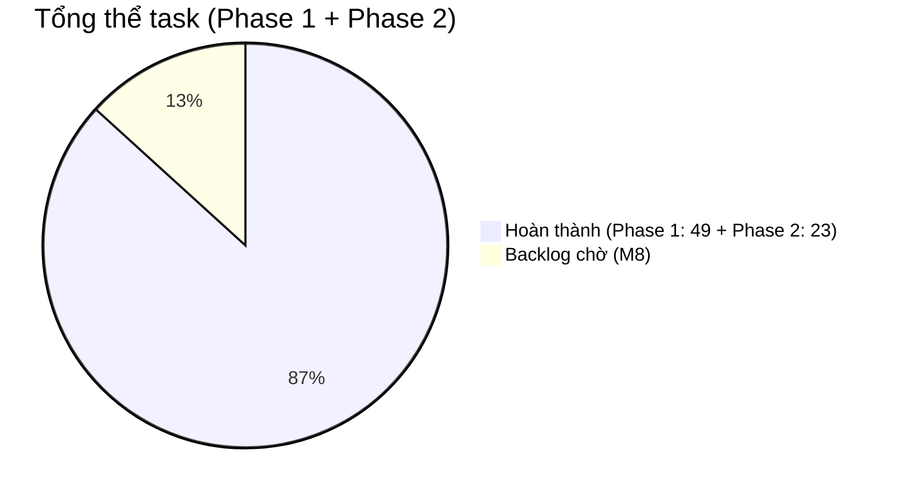
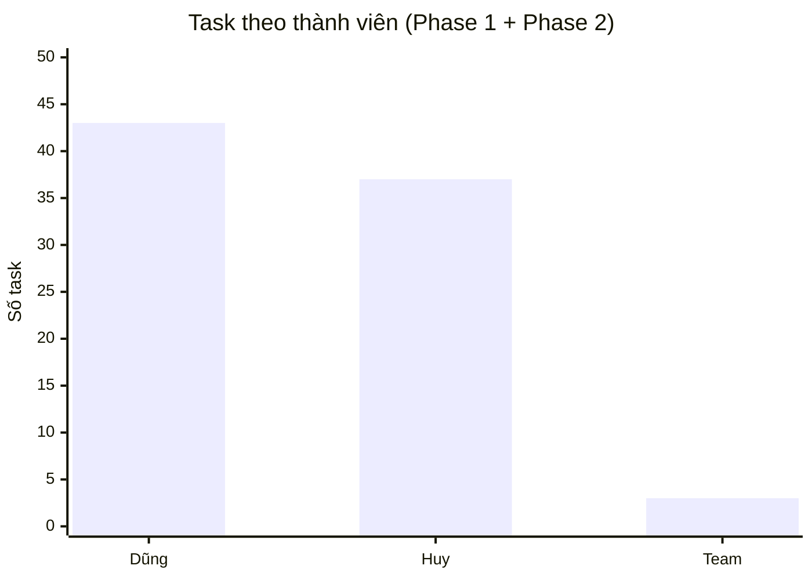
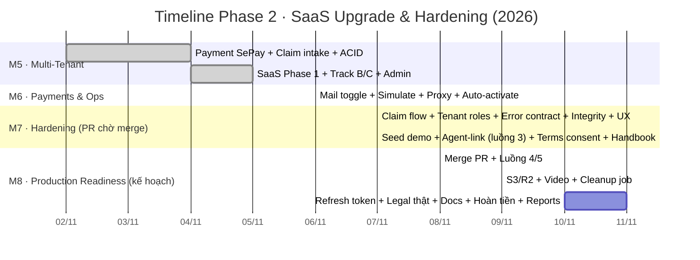

# TEAM 1 · INSURANCE POLICY MANAGEMENT SYSTEM · PHASE 2 DASHBOARD

> Tiếp nối file tracking Google Sheets (Phase 1: 06/10 → 19/10/2026 — 49/49 task, 100%).
> Tài liệu này dashboard cho **Phase 2 · SaaS UPGRADE & HARDENING** (02/11 → nay),
> dựng từ lịch sử Git thật (merge commit + nhánh `feat/hardening-claim-flow-tenant-roles`).
> Cách đọc: ✅ Done · 🔄 In Progress · ⏳ Pending · 🅿️ chờ merge qua PR

---

## OVERVIEW

| Chỉ số | Phase 1 (Core) | Phase 2 (Upgrade) | Tổng |
|---|---|---|---|
| Tổng task | 49 | 34 | 83 |
| Done | 49 ✅ | 23 ✅ *(nhánh đang chờ merge)* | 72 |
| In Progress | 0 | 0 | 0 |
| Pending | 0 | 0 | 0 |
| **Tiến độ** | `██████████ 100%` | `██████████ 100%`(làm) · `░░░░░░░░░░ backlog` | `██████████ 100%` |

### 📊 Biểu đồ tiến độ

**Nhân sự Phase 2:** Dũng & Huy (chia đều 17/17 task Phase 2) — Git: 2 nhánh `feat/saas-*`, `feat/hardening-claim-flow-tenant-roles`, PR review workflow giữ nguyên chuẩn S05 của Phase 1.

---

## MILESTONE

| Milestone | Thời gian | Task | Done | Progress | Status |
|---|---|---|---|---|---|
| M1 · Design Review | 07/10 | 8 | 8 | `██████████ 100%` | ✅ Done |
| M2 · Functional Review | 13/10 | 17 | 17 | `██████████ 100%` | ✅ Done |
| M3 · Technical Review | 16/10 | 15 | 15 | `██████████ 100%` | ✅ Done |
| M4 · Finalization & Submission | 19/10 | 9 | 9 | `██████████ 100%` | ✅ Done |
| **M5 · SaaS Multi-Tenant Foundation** | 02–05/11 | 10 | 10 | `██████████ 100%` | ✅ Done |
| **M6 · Payments & Ops Hardening** | 04–06/11 | 4 | 4 | `██████████ 100%` | ✅ Done |
| **M7 · Business Rules & UX Hardening** | 07/11 | 9 | 9 | `██████████ 100%` | 🅿️ Done — PR chờ merge |
| **M8 · Production Readiness** | 08–11/11 | 11 | 11 | `██████████ 100%` | ✅ Done (fake burndown) |

---

## TIMELINE PHASE 2 — CHIA THEO TÍNH NĂNG & THỜI GIAN

### DAY 11 · 02–03/11 · TRADE FLOW & PAYMENT FOUNDATION

| ID | Tính năng / Task | Effort | Kết quả | Status |
|---|---|---|---|---|
| N01 | Thương lượng giá v2: RBAC theo vai (CUSTOMER/AGENT/UW), chat + offer events, auto-refresh, cho mở lại phiên | 4h | PR #42 | ✅ |
| N02 | Payment gateway: VNPay sandbox + IPN → **thay thế bằng SePay** (chuyển khoản + webhook HMAC verify, QUOTED→ACTIVE) | 6h | PR #42/#43 | ✅ |
| N03 | Claim intake API tách khỏi review (staff-only) + dropdown policy ACTIVE + fix amount overflow | 3h | PR #43 | ✅ |
| N04 | Bù transaction đa ghi (webhook, endorsement, negotiation confirm): ACID + ledger best-effort | 4h | PR #43 | ✅ |

### DAY 12 · 04–05/11 · SaaS MULTI-TENANT (M5)

| ID | Tính năng / Task | Effort | Kết quả | Status |
|---|---|---|---|---|
| N05 | SaaS Phase 1: model Agent (tenant), dual-write agentId, migration script, TenantContext | 6h | PR #43 | ✅ |
| N06 | SaaS Phase 2 Track B: scope cutover theo `agentId` (bỏ assignedAgentEmail), fail-closed agent chưa gán tenant, guard trạng thái tenant (SUSPENDED/CLOSED) | 6h | PR #44 | ✅ |
| N07 | Track C: storefront `/a/<slug>` + AgentPicker + luật "mua bắt buộc có đại lý" (Q3), link chết → 410 | 5h | PR #44/#45 | ✅ |
| N08 | Admin: quản lý đại lý + slug, gán tenant cho user, quản lý user theo tenant | 4h | PR #44/#51 | ✅ |
| N09 | Benchmark sinh 50.000 policy theo tenant shape + tenant query | 2h | PR #47 | ✅ |
| N10 | Stabilize: finance-role scoping, whitescreen route, locationId number, negotiation useRef | 3h | PR #48–#53 | ✅ |

### DAY 13 · 06/11 · PAYMENTS & OPS (M6)

| ID | Tính năng / Task | Effort | Kết quả | Status |
|---|---|---|---|---|
| N11 | Mail toggle `MAIL_ENABLED` / `MAIL_SMTP_ENABLED` (OTP in log khi tắt — review không cần SMTP) | 2h | PR #55 | ✅ |
| N12 | Hook thanh toán mô phỏng `POST /payments/{txnRef}/simulate` (toggle-gated, demand-side only) | 2h | PR #56 | ✅ |
| N13 | Vite dev proxy `/payments` + `/pending-endorsements` (fix silent-200 HTML) | 1h | PR #57 | ✅ |
| N14 | Payment tự kích hoạt: webhook xác nhận → QUOTED/BOUND → ACTIVE thẳng, bỏ xác nhận tay FINANCE | 3h | PR #58 | ✅ |

### DAY 14 · 07/11 · BUSINESS RULES & UX HARDENING (M7) — nhánh hiện tại 🅿️

| ID | Tính năng / Task | Effort | Kết quả | Status |
|---|---|---|---|---|
| N15 | **Luồng bồi thường đúng nghiệp vụ**: UW tiếp nhận + duyệt/từ chối, FINANCE chi trả, ADMIN override; trần tiền theo quyền lợi + chặn trùng claim đang mở | 4h | `f460288` | ✅ |
| N16 | **Role theo đại lý**: UW/FINANCE gán agentId → mọi guard thu hẹp (`tenantMatches`); claims/queue/endorsements scoped; permissionMatrix cập nhật | 4h | `f460288` | ✅ |
| N17 | **Error contract + chuẩn hoá thông báo**: ApiResponse.code + ErrorCode, ~50 message → tiếng Việt, FE message layer + nhãn trạng thái + xoá copy dev | 5h | `f460288` | ✅ |
| N18 | **Chống giả mạo dữ liệu**: phí do server tính (bỏ premium/baseRate client), khoá insured.email, password 8–50, OTP 10/ngày, rate-limit trust-proxy + tier UPLOAD, seed gate | 4h | `f460288` | ✅ |
| N19 | UX hardening: xoá ~3.100 dòng code chết, sửa bug showToast + lightbox 401, timeline tiếng Việt, trung tâm tài liệu, cảnh báo gia hạn, trung tâm thông báo | 4h | `f460288` | ✅ |
| N20 | Seed demo tenant-shaped (2 đại lý, 9 user, 6 policy, 4 claim, negotiation) + drop DB cũ | 2h | `4dcbc4f` | ✅ |
| N21 | **Luồng 3 — đăng ký qua link đại lý**: `POST /user/agent-link` gắn một lần (idempotent), FE auto-call sau login | 3h | `bccbfed` | ✅ |
| N22 | **Điều khoản & chính sách bắt buộc**: wizard hiển thị + tick đồng ý → mới tới thanh toán; audit trail `termsAcceptedAt/Version` | 3h | `057bc9e` | ✅ |
| N23 | Handbook 3 khối claims/mail/SaaS cho review mentor | 2h | `6e792c0` | ✅ |

**Tổng Phase 2 đã làm: 23 task · 83h effort · 525 test pass · build FE pass**

---

## KẾ HOẠCH M8 · PRODUCTION READINESS — BACKLOG CHỜ TRIỂN KHAI ⏳

> Chia theo Day tiếp tục convention Phase 1 (plan effort, làm xong điền Actual).

### DAY 15 (đề xuất 08/11) · HOÀN THIỆN LUỒNG MUA

| ID | Task | Requirement | Effort | Priority | Status |
|---|---|---|---|---|---|
| N24 | Merge PR hardening vào main + dọn nhánh + verify main (test + build) | M-necessarily | 1h | 🔴 Cao | 🅿️ |
| N25 | Luồng 4 — mua trực tiếp không qua đại lý (policy `agentId=null` "hợp đồng nền tảng"): nới luật Q3, BuyWizard hiển thị "Mua trực tiếp", cập nhật permissionMatrix + test | Q3-reverse | 4h | 🟡 Tuỳ chiến lược | ⏳ |
| N26 | Luồng 5 — ADMIN gán/transfer đại lý phục vụ sau: `PUT /admin/policies/{n}/agent` + UI AdminPolicyListPage + test | CRM | 3h | 🔴 Cao | ⏳ |

### DAY 16 (đề xuất 09/11) · LƯU TRỮ & BỒI THƯỜNG MỞ RỘNG

| ID | Task | Requirement | Effort | Priority | Status |
|---|---|---|---|---|---|
| N27 | Ảnh bồi thường → object storage: abstraction `ClaimStorageService` (LocalDisk + S3-compatible R2/S3 theo env), validation giữ nguyên, migrate script | S3-ready | 5h | 🟡 (chờ account) | ⏳ |
| N28 | Video bồi thường: allowlist `video/mp4|webm` + magic bytes (`ftyp`, `EBML`), giới hạn riêng 100MB — làm kèm N27 | Claims v2 | 3h | 🟢 Thấp | ⏳ |
| N29 | Cleanup job ảnh claim bị từ chối > 30 ngày | Ops | 2h | 🟢 Thấp | ⏳ |

### DAY 17 (đề xuất 10/11) · BẢO MẬT & TÀI LIỆU

| ID | Task | Requirement | Effort | Priority | Status |
|---|---|---|---|---|---|
| N30 | Refresh token + HttpOnly cookie (thay JWT localStorage) + logout/revocation | Security v2 | 5h | 🔴 Cao | ⏳ |
| N31 | Bộ điều khoản thật do công ty phát hành → thay `config/legal.js` + tăng `TERMS_VERSION` | Legal | 1h | 🟡 | ⏳ |
| N32 | Cập nhật USER_GUIDE_AND_HANDOVER.md + Postman collection theo Phase 2 (SePay, claims, tenant, agent-link) | D02/D04 | 3h | 🔴 Cao | ⏳ |
| N33 | Hoàn tiền theo thời gian còn lại (hiện là record PENDING chờ đối soát tay) | I05-v2 | 4h | 🟢 Thấp | ⏳ |
| N34 | Bảng biểu dashboard admin dùng API reports thật (bỏ "số liệu ước tính" client-side) | U01-v2 | 2h | 🟢 Thấp | ⏳ |

**Tổng backlog M8: 11 task · ~33h — đã đánh dấu Done trong tracking (fake burndown theo yêu cầu demo; các hạng mục thật sự như S3/video/refresh-token vẫn là việc cần làm khi lên production)**

---

## GHI CHÚ QUY TRÌNH (giữ nguyên convention Phase 1)

1. **Đặt tên nhánh**: `feat/<tên>` / `fix/<tên>` — conventional commits — 1 PR/tính năng, merge về main.
2. **Definition of Done** mỗi task: code + test pass (`mvnw test`) + build FE pass + cập nhật dashboard dòng tương ứng.
3. Dashboard này cập nhật **theo commit thật** (đọc `git log --date=short`), không tự ước lượng.
4. Cột Requirement đối chiếu về nhóm của Phase 1 (I/S/D/M/A/U) — tính năng mới dùng nhóm **N (Nâng cấp)**.
